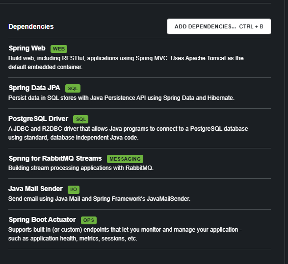
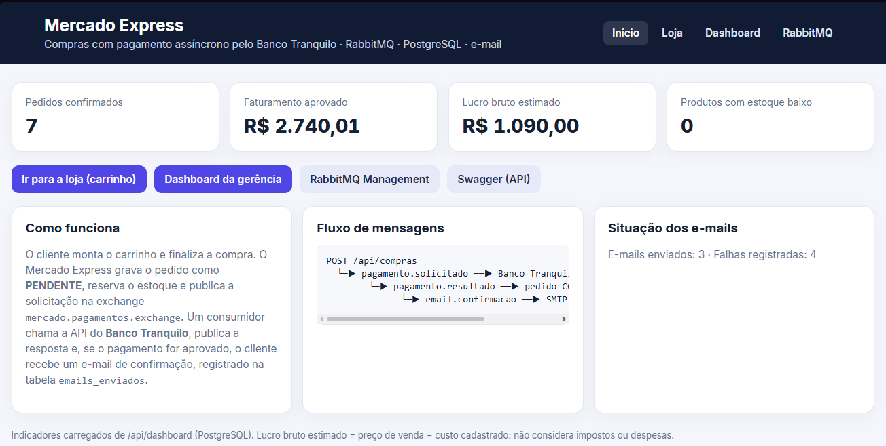
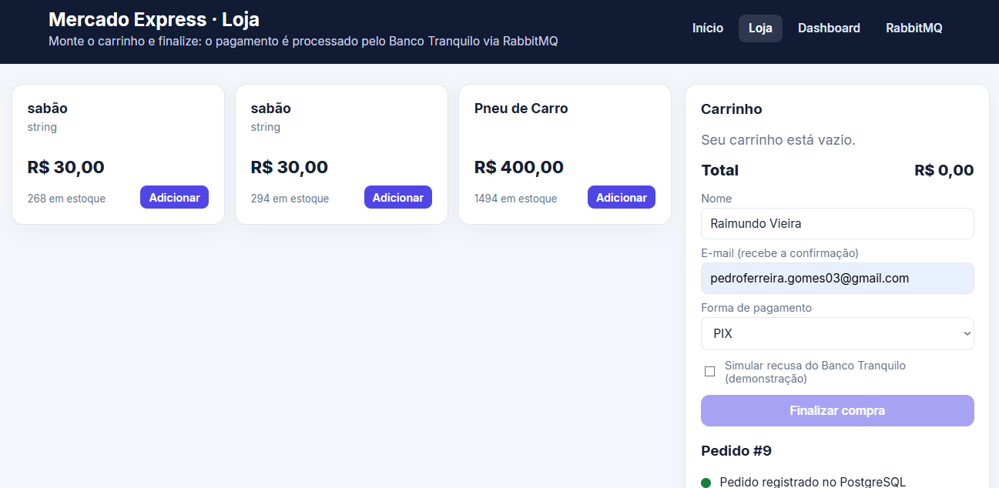
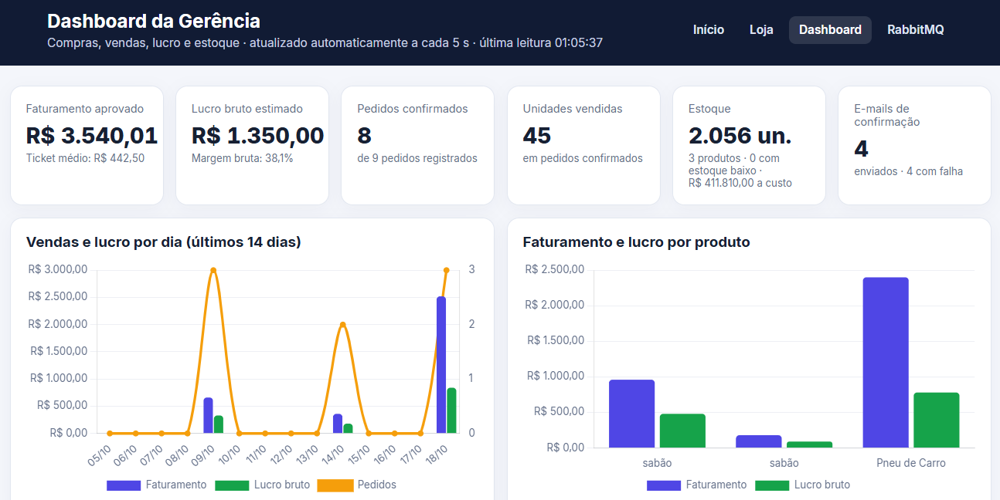
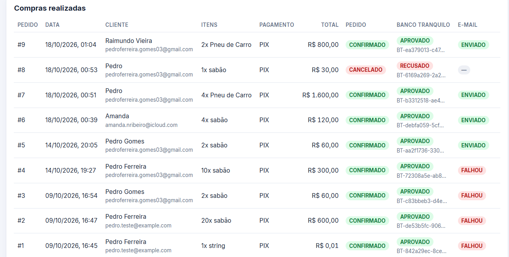
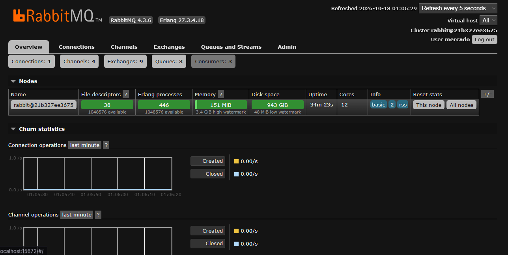
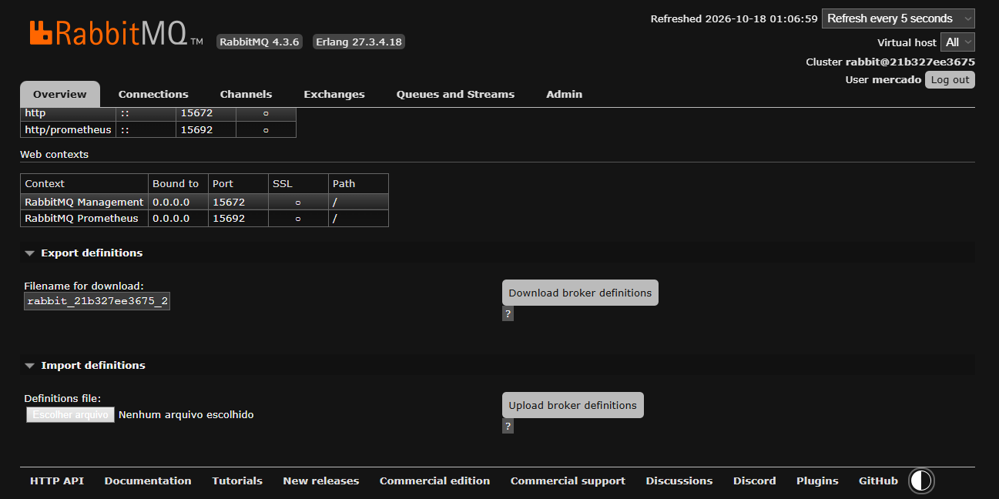
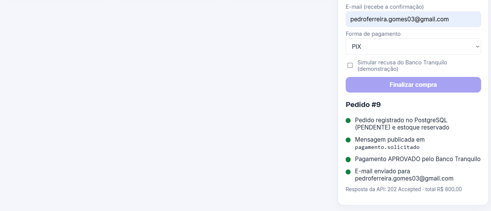
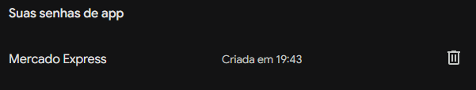

# CP5 — Parte 2 | Mercado Express + Banco Tranquilo

Microsserviços em **Java 21 / Spring Boot 3.4.5** que integram o **Mercado Express** à API de pagamentos do **Banco Tranquilo** usando **RabbitMQ** como broker. Compras confirmadas geram um **e-mail de confirmação de pagamento**, registrado no **PostgreSQL**, e a gerência acompanha tudo em um **dashboard com gráficos** de vendas, lucro e estoque. O acesso é protegido com **Spring Security**: tela de login própria, cadastro de clientes e perfis **ADMIN** e **CLIENTE**.

- **Disciplina:** Java Advanced, prof. Dr. Marcel Stefan Wagner (FIAP, TDS)
- **IDE:** IntelliJ IDEA
- **Vídeo de demonstração:** _adicionar o link do YouTube (não listado)_
- **Aplicação em produção (Azure):** _http://SEU-DNS-OU-IP/_ (login: veja a seção 5.2)
- **Repositório:** [github.com/2TDSPO-JPG/CP5_MercadoExpress](https://github.com/2TDSPO-JPG/CP5_MercadoExpress)

---

## Sumário
1. [Arquitetura](#1-arquitetura)
2. [RabbitMQ: exchange, filas e routing keys](#2-rabbitmq-exchange-filas-e-routing-keys)
3. [Tecnologias e dependências](#3-tecnologias-e-dependências)
4. [Como executar](#4-como-executar)
5. [Segurança (Spring Security)](#5-segurança-spring-security)
6. [Telas](#6-telas)
7. [Endpoints](#7-endpoints)
8. [Exemplos de requisição (Postman/Insomnia)](#8-exemplos-de-requisição-postmaninsomnia)
9. [Testes pelo RabbitMQ Management](#9-testes-pelo-rabbitmq-management)
10. [Envio de e-mail (Gmail SMTP)](#10-envio-de-e-mail-gmail-smtp)
11. [Banco de dados](#11-banco-de-dados)
12. [Tratamento de erros](#12-tratamento-de-erros)
13. [Estrutura do projeto](#13-estrutura-do-projeto)
14. [Deploy na Azure](#14-deploy-na-azure)

---

## 1. Arquitetura

```
 ┌──────────────┐  POST /api/compras   ┌──────────────────────────────────────────────┐
 │ Loja (web) / │ ───────────────────▶ │ MERCADO EXPRESS (:8082)                      │
 │   Postman    │ ◀─── 202 Accepted ── │  grava Pedido/Itens/Pagamento (PENDENTE)     │
 └──────────────┘                      │  reserva estoque e publica a mensagem        │
                                       └──────────────┬───────────────────────────────┘
                                                      │ routing key: pagamento.solicitado
                                                      ▼
                             ┌──────────── RabbitMQ: mercado.pagamentos.exchange (topic) ─────────────┐
                             │   fila pagamento.solicitado   fila pagamento.resultado   fila email.confirmacao │
                             └───────┬───────────────────────────▲──────────┬────────────────────▲──────┬──┘
                                     │                           │          │                    │      │
                                     ▼                           │          ▼                    │      ▼
                            PagamentoConsumer ── HTTP POST ──▶ BANCO TRANQUILO (:8081)    Resultado     EmailConsumer
                            (chama a API do banco)  /api/pagamentos  APROVADO/RECUSADO  PagamentoConsumer   ├─ envia e-mail (SMTP)
                                     └──────── publica resposta ─┘                     ├─ CONFIRMADO/CANCELADO └─ grava emails_enviados
                                                                                        └─ publica e-mail se aprovado
```

**Fluxo de uma compra**
1. O cliente finaliza o carrinho na **Loja** (`/loja`) ou envia `POST /api/compras` pelo Postman.
2. O Mercado Express valida o estoque, **reserva** as unidades e grava `pedidos`, `itens_pedido` e `pagamentos` com status **PENDENTE**. Em seguida publica a mensagem na fila `pagamento.solicitado` e responde **202 Accepted**.
3. O `PagamentoConsumer` consome a fila e chama a **API do Banco Tranquilo** (`POST :8081/api/pagamentos`).
4. A resposta (APROVADO/RECUSADO e `transacaoId`) é publicada na fila `pagamento.resultado`.
5. O `ResultadoPagamentoConsumer` atualiza o pagamento e o pedido:
   - **APROVADO** → pedido **CONFIRMADO** e mensagem publicada em `email.confirmacao`.
   - **RECUSADO** → pedido **CANCELADO** e o estoque reservado é devolvido.
6. O `EmailConsumer` envia o **e-mail de confirmação de pagamento** e grava o resultado (ENVIADO/FALHOU) na tabela `emails_enviados`.
7. O **Dashboard da gerência** (`/dashboard`) mostra compras, vendas, lucro e estoque em tempo real.

## 2. RabbitMQ: exchange, filas e routing keys

Tudo é declarado automaticamente na inicialização, em `RabbitConfig.java`.

| Tipo | Nome | Routing key | Produtor | Consumidor |
|---|---|---|---|---|
| Exchange (topic, durável) | `mercado.pagamentos.exchange` | — | — | — |
| Fila durável | `pagamento.solicitado` | `pagamento.solicitado` | `CompraService` | `PagamentoConsumer` |
| Fila durável | `pagamento.resultado` | `pagamento.resultado` | `PagamentoConsumer` | `ResultadoPagamentoConsumer` |
| Fila durável | `email.confirmacao` | `email.confirmacao` | `ResultadoPagamentoConsumer` | `EmailConsumer` |

As mensagens trafegam em **JSON** (`Jackson2JsonMessageConverter`). Os consumidores têm **retry** (3 tentativas) e são **idempotentes**: uma mensagem repetida para um pagamento que já saiu de PENDENTE é ignorada.

## 3. Tecnologias e dependências

Projetos criados pelo **Spring Initializr** (Maven, Java 21, Spring Boot 3.4.5).

| Serviço | Dependências |
|---|---|
| `mercado-express` | Spring Web, **Spring Security**, Spring Data JPA, **Spring for RabbitMQ (AMQP)**, **Java Mail Sender**, Validation, Thymeleaf, Actuator, PostgreSQL Driver, Lombok, springdoc-openapi (Swagger) |
| `banco-tranquilo-api` | Spring Web, Validation, Actuator |

Dependências selecionadas no Spring Initializr:



Infraestrutura local pelo `docker-compose.yml`: **RabbitMQ 4 (com Management)** e **PostgreSQL 16**. Gráficos com **Chart.js** (CDN).

## 4. Como executar

**Pré-requisitos:** JDK 21, Maven 3.9+ (ou o Maven da IDE), Docker Desktop e Postman ou Insomnia.

### 4.1 Subir RabbitMQ e PostgreSQL
Na raiz do projeto:
```bash
docker compose up -d
```

| Serviço | Endereço | Usuário / senha |
|---|---|---|
| RabbitMQ Management | http://localhost:15672 | `mercado` / `mercado_dev_123` |
| RabbitMQ (AMQP) | `localhost:5672` | `mercado` / `mercado_dev_123` |
| PostgreSQL | `localhost:5433`, banco `mercado_express` | `mercado` / `mercado_dev_123` |

> O PostgreSQL do container é exposto na porta **5433** do computador para não conflitar com um PostgreSQL já instalado na 5432. Essas credenciais são **apenas de desenvolvimento local**.

### 4.2 Configurar o e-mail
Configure as variáveis `MAIL_*` (veja a [seção 10](#10-envio-de-e-mail-gmail-smtp)). Sem elas a aplicação funciona normalmente, mas o e-mail fica registrado com status `FALHOU`.

### 4.3 Iniciar os dois serviços
Pelo IntelliJ, rode `BancoTranquiloApplication` e depois `MercadoExpressApplication`. Ou pelo terminal:
```bash
# Terminal 1
cd banco-tranquilo-api
mvn spring-boot:run

# Terminal 2
cd mercado-express
mvn spring-boot:run
```

| Página / serviço | URL |
|---|---|
| Página inicial | http://localhost:8082 |
| **Login** / **Cadastro** | http://localhost:8082/login · http://localhost:8082/cadastro |
| **Loja com carrinho** | http://localhost:8082/loja |
| **Dashboard da gerência** | http://localhost:8082/dashboard |
| Swagger da API | http://localhost:8082/swagger-ui/index.html |
| Banco Tranquilo (health) | http://localhost:8081/api/pagamentos/health |
| Health check | http://localhost:8082/actuator/health |

Na primeira execução, com a tabela vazia, são cadastrados **6 produtos de exemplo** (`DataLoader`). Para desligar, use `SEED_PRODUTOS=false`.

### 4.4 Variáveis de ambiente (todas opcionais, com valores padrão)

| Variável | Padrão |
|---|---|
| `DB_URL` / `DB_USERNAME` / `DB_PASSWORD` | `jdbc:postgresql://localhost:5433/mercado_express` / `mercado` / `mercado_dev_123` |
| `RABBITMQ_HOST` / `RABBITMQ_PORT` / `RABBITMQ_USERNAME` / `RABBITMQ_PASSWORD` | `localhost` / `5672` / `mercado` / `mercado_dev_123` |
| `BANCO_TRANQUILO_URL` | `http://localhost:8081` |
| `BANCO_API_KEY` (nos dois serviços) | `bt-dev-chave-local-123` |
| `ADMIN_EMAIL` / `ADMIN_PASSWORD` | `admin@mercadoexpress.com` / `Admin@2026` |
| `CLIENTE_EMAIL` / `CLIENTE_PASSWORD` | `cliente@mercadoexpress.com` / `Cliente@2026` |
| `MAIL_HOST`, `MAIL_PORT`, `MAIL_USERNAME`, `MAIL_PASSWORD`, `MAIL_FROM` | Gmail, porta 587, sem credenciais |

## 5. Segurança (Spring Security)

O Mercado Express usa **Spring Security** com tela de login própria (não a página padrão do framework), cadastro de novos clientes e dois perfis de acesso. A API do Banco Tranquilo é protegida por chave.

### 5.1 Perfis e permissões

| Recurso | Visitante | CLIENTE | ADMIN (gerência) |
|---|:---:|:---:|:---:|
| Página inicial `/`, `/login`, `/cadastro` | ✅ | ✅ | ✅ |
| Loja `/loja` e consulta de produtos | — | ✅ | ✅ |
| Fazer compra `POST /api/compras` | — | ✅ (sempre com o e-mail da própria conta) | ✅ |
| Ver pedido / status `GET /api/compras/{id}` | — | ✅ só os próprios | ✅ todos |
| Dashboard `/dashboard` e `/api/dashboard/**` | — | ❌ 403 | ✅ |
| Cadastrar, editar e excluir produtos | — | ❌ 403 | ✅ |
| Histórico de e-mails `/api/emails` | — | ❌ 403 | ✅ |
| Reprocessar pagamento | — | ❌ 403 | ✅ |
| Swagger `/swagger-ui` | — | ❌ 403 | ✅ |

### 5.2 Usuários de demonstração
Criados automaticamente na primeira execução (`DataLoader`), apenas se ainda não existirem:

| Perfil | E-mail | Senha |
|---|---|---|
| ADMIN | `admin@mercadoexpress.com` | `Admin@2026` |
| CLIENTE | `cliente@mercadoexpress.com` | `Cliente@2026` |

Para trocar, use as variáveis `ADMIN_EMAIL`, `ADMIN_PASSWORD`, `CLIENTE_EMAIL` e `CLIENTE_PASSWORD`. Novos clientes se cadastram em **`/cadastro`**.

### 5.3 Como funciona
- **Login** em `/login` (e-mail e senha). Depois de entrar, a gerência vai para o `/dashboard` e o cliente vai para a `/loja`. Quem acessa uma página protegida sem login é levado para a tela de login.
- **Cadastro (Sign Up)** em `/cadastro`: cria uma conta com perfil CLIENTE. A senha precisa ter 8 ou mais caracteres, com letras e números, e o e-mail não pode estar em uso. Depois do cadastro, o usuário é levado ao login.
- **Senhas** guardadas apenas como hash **BCrypt** na tabela `usuarios_mercado`.
- **CSRF** ativo nas páginas: formulários e chamadas `fetch` enviam o token gerado pelo Spring Security. Requisições do Postman com HTTP Basic não usam cookie de sessão e, por isso, não precisam do token.
- **Sessão**: novo ID de sessão a cada login (proteção contra *session fixation*), cookie `HttpOnly`/`SameSite=Lax`, expiração em 30 minutos e **logout** pelo botão "Sair".
- **API REST**: sem login devolve **401**; sem permissão devolve **403**. Para Postman/Insomnia, use **Basic Auth** com e-mail e senha.
- **Isolamento de dados**: o cliente só consulta os próprios pedidos e não consegue comprar em nome de outro e-mail.
- **Cabeçalhos de segurança**: `X-Frame-Options: DENY`, `X-Content-Type-Options: nosniff`, `Cache-Control: no-store` e `Referrer-Policy`.
- **Banco Tranquilo**: `POST /api/pagamentos` exige o cabeçalho **`X-API-KEY`** (variável `BANCO_API_KEY`, igual nos dois serviços). Sem a chave correta, a resposta é 401. O Mercado Express envia a chave automaticamente.

## 6. Telas

> Os prints ficam na pasta `docs/img/`.

### 6.0 Login e cadastro (`/login`, `/cadastro`)
Tela de login própria, com mensagens de erro, de logout e de conta criada. O cadastro cria clientes e valida e-mail e força da senha.



### 6.1 Loja: carrinho e finalização da compra (`/loja`)
O cliente adiciona produtos ao carrinho, informa nome, e-mail e forma de pagamento e finaliza a compra. A tela acompanha o processamento assíncrono em tempo real: pedido registrado → mensagem publicada → resposta do Banco Tranquilo → e-mail enviado. A opção **"Simular recusa"** demonstra o fluxo de pagamento recusado. Nome e e-mail vêm da conta logada, e a seção **"Meus pedidos"** lista as compras do cliente.



### 6.2 Dashboard da gerência (`/dashboard`)
Atualiza sozinho a cada 5 segundos, com dados lidos do PostgreSQL:
- **Indicadores:** faturamento aprovado, ticket médio, lucro bruto e margem, pedidos confirmados, unidades vendidas, estoque (unidades e valor a custo) e e-mails enviados/com falha.
- **Gráficos:** vendas e lucro por dia; faturamento e lucro por produto; estoque por produto (estoque baixo em vermelho); pedidos por status.
- **Compras realizadas:** cliente, itens, total, status do pedido, resposta do Banco Tranquilo (com `transacaoId`) e status do e-mail. Pedidos com erro de comunicação podem ser **reprocessados**.
- **Produtos e estoque:** cadastrar, ajustar estoque e excluir produtos (CRUD).
- **Controle de e-mails:** conteúdo da tabela `emails_enviados`.




### 6.3 RabbitMQ Management



### 6.4 Postman
Collection em `postman/CP5-Mercado-Express.postman_collection.json` (detalhes na seção 8).

### 6.5 E-mail de confirmação recebido


## 7. Endpoints

### Mercado Express (`:8082`)
| Método | Endpoint | Perfil | Finalidade |
|---|---|---|---|
| GET/POST | `/login` | público | Tela de login / autenticação (formulário) |
| GET/POST | `/cadastro` | público | Cadastro de cliente (Sign Up) |
| POST | `/logout` | logado | Sair |
| GET | `/api/me` | público | Dados do usuário logado (ou `autenticado: false`) |
| GET | `/api/produtos` · `/api/produtos/{id}` | CLIENTE, ADMIN | Lista / consulta produtos |
| POST · PUT · DELETE | `/api/produtos` · `/api/produtos/{id}` | ADMIN | Cadastra / atualiza / exclui produto |
| POST | `/api/compras` | CLIENTE, ADMIN | Registra compra e publica em `pagamento.solicitado` (202) |
| GET | `/api/compras/{id}` | dono ou ADMIN | Consulta pedido |
| GET | `/api/compras/{id}/status` | dono ou ADMIN | Pedido, pagamento e e-mail |
| GET | `/api/compras/minhas` | CLIENTE, ADMIN | Pedidos do usuário logado |
| POST | `/api/compras/{id}/reprocessar` | ADMIN | Reenvia para a fila um pedido com pagamento em ERRO |
| GET | `/api/dashboard` | ADMIN | Indicadores gerais |
| GET | `/api/dashboard/vendas-por-dia?dias=14` | ADMIN | Faturamento, lucro e pedidos por dia |
| GET | `/api/dashboard/produtos` | ADMIN | Vendas, lucro e estoque por produto |
| GET | `/api/dashboard/compras?limite=50` | ADMIN | Compras realizadas com pagamento e e-mail |
| GET | `/api/emails` | ADMIN | Histórico de e-mails (`emails_enviados`) |

### Banco Tranquilo (`:8081`)
| Método | Endpoint | Acesso | Finalidade |
|---|---|---|---|
| POST | `/api/pagamentos` | cabeçalho `X-API-KEY` | Autoriza ou recusa um pagamento e devolve `transacaoId` |
| GET | `/api/pagamentos/health` | público | Status do serviço |

## 8. Exemplos de requisição (Postman/Insomnia)

Importe `postman/CP5-Mercado-Express.postman_collection.json`. A collection:
- usa **Basic Auth** com o usuário ADMIN (variáveis `adminEmail` e `adminSenha`) e envia `X-API-KEY` nas chamadas diretas ao Banco Tranquilo;
- tem a pasta **"0. Segurança"**, que prova as regras de acesso: sem login → 401, senha errada → 401, cliente no dashboard → 403, cliente cadastrando produto → 403, Banco Tranquilo sem chave → 401;
- tem **scripts de teste automáticos**: valida os códigos HTTP e guarda o `pedidoId` criado.

Altere `emailCliente` para o seu e-mail e rode a collection inteira pelo **Collection Runner**.

> No Insomnia ou no curl, use Basic Auth: `curl -u admin@mercadoexpress.com:Admin@2026 http://localhost:8082/api/dashboard`

**Compra (JSON):**
```http
POST http://localhost:8082/api/compras
Content-Type: application/json
```
```json
{
  "clienteNome": "Cliente Demonstração",
  "clienteEmail": "seu-email@exemplo.com",
  "metodoPagamento": "PIX",
  "itens": [
    { "produtoId": 1, "quantidade": 2 },
    { "produtoId": 2, "quantidade": 1 }
  ]
}
```
**Resposta (202 Accepted):**
```json
{ "pedidoId": 1, "status": "PENDENTE", "total": 45.79, "mensagem": "Compra recebida para processamento assíncrono." }
```
Em cerca de 1 segundo, `GET /api/compras/1` passa a retornar `"status": "CONFIRMADO"`.

**Simular pagamento recusado:** acrescente `"resultadoSimulado": "RECUSADO"` ao JSON. Esse campo existe **apenas para a demonstração acadêmica**. O pedido fica `CANCELADO`, o estoque volta e nenhum e-mail é enviado.

**Cadastro de produto:**
```json
{ "nome": "Café 500g", "descricao": "Café torrado e moído", "precoCusto": 12.50, "precoVenda": 19.90, "estoque": 30 }
```

Métodos de pagamento aceitos pela loja: `PIX`, `CARTAO_CREDITO`, `CARTAO_DEBITO`, `BOLETO`. O cabeçalho opcional `Idempotency-Key` evita pedidos duplicados quando a mesma requisição é reenviada.

## 9. Testes pelo RabbitMQ Management

Acesse http://localhost:15672 (`mercado` / `mercado_dev_123`).

1. **Exchanges → `mercado.pagamentos.exchange`:** mostra os 3 bindings e a taxa de mensagens (*message rates*) durante as compras.
2. **Queues:** as filas `pagamento.solicitado`, `pagamento.resultado` e `email.confirmacao`, cada uma com **1 consumidor**. Faça compras pela loja ou pelo Postman e acompanhe os gráficos *Message rates*.
3. **Publicar uma mensagem manualmente (teste interno):** em **Queues → `email.confirmacao` → Publish message**:
   - **Properties:** `content_type` = `application/json`
   - **Payload:**
     ```json
     {"pedidoId": 1, "clienteNome": "Teste RabbitMQ", "clienteEmail": "seu-email@exemplo.com", "statusPagamento": "APROVADO", "valor": "45.79"}
     ```
   Clique em **Publish message**. O `EmailConsumer` consome a mensagem, envia o e-mail e grava em `emails_enviados`; o registro aparece no dashboard.
4. **Get messages:** para inspecionar uma mensagem parada na fila, pare o Mercado Express (os consumidores somem), publique uma mensagem em `email.confirmacao` como no passo 3 e use **Get messages** para ver o JSON. Ao subir a aplicação de novo, a mensagem é consumida.
5. **Banco fora do ar:** pare o `banco-tranquilo-api` e faça uma compra. O pagamento fica `ERRO`, o pedido `ERRO_PAGAMENTO` e o estoque é devolvido. Suba o banco novamente e clique em **Reprocessar** no dashboard (ou `POST /api/compras/{id}/reprocessar`).

## 10. Envio de e-mail (Gmail SMTP)

O e-mail de confirmação é enviado pelo SMTP do Gmail: `smtp.gmail.com`, porta `587`, autenticação ligada e STARTTLS. Cada tentativa é registrada na tabela `emails_enviados` com status `ENVIADO` ou `FALHOU` e o detalhe do servidor.

**Variáveis de ambiente:**
```env
MAIL_HOST=smtp.gmail.com
MAIL_PORT=587
MAIL_USERNAME=seuemail@gmail.com
MAIL_PASSWORD=sua_senha_de_app
MAIL_SMTP_AUTH=true
MAIL_STARTTLS=true
MAIL_FROM=seuemail@gmail.com
```



- Use uma **senha de app** do Google, não a senha normal da conta. Ela exige a verificação em duas etapas ativada: https://myaccount.google.com/apppasswords
- **Nunca versione a senha.** O `.gitignore` ignora arquivos `*.env`.

**No IntelliJ:** *Run → Edit Configurations → Environment variables*, uma variável por linha. Não coloque todas no campo `MAIL_HOST`.

**No PowerShell:**
```powershell
$env:MAIL_USERNAME = "seuemail@gmail.com"
$env:MAIL_PASSWORD = "sua_senha_de_app"
$env:MAIL_FROM     = "seuemail@gmail.com"
mvn spring-boot:run
```

**Solução de problemas**
- `Authentication failed` / `535-5.7.8`: senha de app incorreta ou verificação em duas etapas desativada.
- `Senha ausente` / e-mail `FALHOU` sem detalhe: a variável `MAIL_PASSWORD` não está definida no mesmo ambiente em que a aplicação roda.
- `UnknownHostException`: valor errado em `MAIL_HOST` (deve ser só `smtp.gmail.com`).
- E-mail não chegou: confira a caixa de spam e o status em `/api/emails`.

## 11. Banco de dados

**PostgreSQL** (o mesmo da Parte 1). As tabelas são criadas automaticamente pelo Hibernate (`ddl-auto: update`).

```yaml
spring:
  datasource:
    url: jdbc:postgresql://localhost:5433/mercado_express
    username: mercado
    password: mercado_dev_123
```

| Tabela | Conteúdo |
|---|---|
| `usuarios_mercado` | nome, e-mail (login), hash BCrypt da senha, perfil (ADMIN/CLIENTE), ativo |
| `produtos` | nome, descrição, preço de custo, preço de venda, estoque |
| `pedidos` | cliente, e-mail, forma de pagamento, total, status, data, chave de idempotência |
| `itens_pedido` | produto, quantidade, preço e custo unitários no momento da compra |
| `pagamentos` | status (PENDENTE/APROVADO/RECUSADO/ERRO), `transacaoId` do Banco Tranquilo, detalhe |
| `emails_enviados` | controle de envio: pedido, destinatário, assunto, status, detalhe, data |

As consultas de conferência estão em `docs/SQL_CONSULTAS.sql`.

## 12. Tratamento de erros

| Situação | Comportamento |
|---|---|
| Sem login / senha errada | `401` na API; nas páginas, redireciona para `/login` |
| Perfil sem permissão | `403` (página "Acesso negado" no navegador) |
| Chamada ao Banco Tranquilo sem `X-API-KEY` | `401` |
| Estoque insuficiente / produto inexistente | `400` com mensagem; nada é gravado |
| JSON inválido ou campos inválidos (ex.: e-mail) | `400` com os campos que falharam |
| RabbitMQ fora do ar | `503`; a transação é desfeita e a compra não fica "presa" |
| Banco Tranquilo fora do ar | pagamento `ERRO`, pedido `ERRO_PAGAMENTO`, estoque devolvido; permite reprocessar |
| Pagamento recusado | pedido `CANCELADO`, estoque devolvido, sem e-mail |
| Falha no SMTP | e-mail gravado com status `FALHOU` e o motivo |
| Mensagem duplicada | consumidores idempotentes ignoram |

## 13. Estrutura do projeto

```
CP5_Parte2_MercadoExpress/
├── docker-compose.yml            # RabbitMQ + PostgreSQL (desenvolvimento local)
├── docker-compose.prod.yml       # produção: RabbitMQ + PostgreSQL + os dois serviços
├── .env.example                  # variáveis de produção (copiar para .env na VM)
├── postman/                      # collection com testes
├── docs/                         # consultas SQL e prints (img/)
├── banco-tranquilo-api/          # API do Banco Tranquilo (:8081)
│   ├── config/ApiKeyFilter.java       # exige X-API-KEY
│   └── controller/PagamentoController.java
└── mercado-express/              # Mercado Express (:8082)
    ├── config/      RabbitConfig (exchange/filas), SecurityConfig (Spring Security), DataLoader
    ├── security/    UsuarioDetailsService, UsuarioService (cadastro + BCrypt)
    ├── controller/  Auth (login/cadastro), Produto, Compra, Dashboard, Home (páginas), ApiExceptionHandler
    ├── service/     CompraService (produtor), PagamentoConsumer, ResultadoPagamentoConsumer, EmailConsumer
    ├── entity/      Usuario, Produto, Pedido, ItemPedido, Pagamento, EmailEnviado
    ├── repository/  Spring Data JPA
    └── resources/
        ├── templates/  index, login, cadastro, loja, dashboard, error/403
        └── static/     css/app.css, js/app.js
```

## 14. Deploy na Azure

Deploy em **Azure App Service (Web App Java 21)**, com build e publicação automáticos pelo **GitHub Actions** a cada push na `main`.

| Componente | Serviço |
|---|---|
| Mercado Express | Azure App Service (Linux, Java 21), plano B1, *Always On* |
| Banco Tranquilo | Azure App Service (Linux, Java 21), mesmo plano |
| PostgreSQL | Azure Database for PostgreSQL – Flexible Server (B1ms, SSL) |
| RabbitMQ | **CloudAMQP**, plano gratuito *Little Lemur*, conexão `amqps://` (a Azure não oferece RabbitMQ gerenciado) |
| E-mail | Gmail SMTP 587 (a Azure bloqueia apenas a porta 25) |
| CI/CD | `.github/workflows/deploy-azure.yml`: Maven build → `azure/webapps-deploy` |

```
Navegador ──HTTPS──▶ mercadoexpress-<sufixo>.azurewebsites.net ──amqps──▶ CloudAMQP (RabbitMQ)
                         │  └──JDBC/SSL──▶ PostgreSQL Flexible Server
                         └──HTTPS + X-API-KEY──▶ bancotranquilo-<sufixo>.azurewebsites.net
```

### 14.1 RabbitMQ (CloudAMQP)
1. Crie uma conta em https://www.cloudamqp.com e uma instância **Little Lemur (Free)**.
2. Na instância, copie a **AMQP URL** (`amqps://...`) e o link do botão **RabbitMQ Manager** (o painel).

### 14.2 Criar a infraestrutura (Azure Cloud Shell, Bash)
```bash
git clone https://github.com/2TDSPO-JPG/CP5_MercadoExpress.git
cd CP5_MercadoExpress
bash azure/criar-recursos.sh SEU-SUFIXO        # ex.: pfg2026 (letras minúsculas e números)
```
O script `azure/criar-recursos.sh`:
- pergunta as senhas sem exibi-las na tela;
- gera uma chave aleatória para a API do Banco Tranquilo;
- cria o plano, os dois Web Apps e o PostgreSQL;
- configura todas as variáveis de ambiente nos Web Apps;
- salva os *publish profiles* em `~/publish-banco.xml` e `~/publish-mercado.xml`.

A região padrão é `canadacentral`. Para outra região liberada, use `LOC=brazilsouth bash azure/criar-recursos.sh SEU-SUFIXO`.

### 14.3 Ligar o GitHub Actions
No GitHub: **Settings → Secrets and variables → Actions**

| Tipo | Nome | Valor |
|---|---|---|
| Secret | `AZURE_PUBLISH_PROFILE_BANCO` | saída de `cat ~/publish-banco.xml` |
| Secret | `AZURE_PUBLISH_PROFILE_MERCADO` | saída de `cat ~/publish-mercado.xml` |
| Variable | `AZURE_WEBAPP_BANCO` | `bancotranquilo-SEU-SUFIXO` |
| Variable | `AZURE_WEBAPP_MERCADO` | `mercadoexpress-SEU-SUFIXO` |

Depois, na aba **Actions**, abra **Deploy na Azure (App Service)** e clique em **Run workflow**. A partir daí, cada push na `main` publica automaticamente.

### 14.4 Acessos
| | URL |
|---|---|
| Aplicação | `https://mercadoexpress-SEU-SUFIXO.azurewebsites.net` |
| Banco Tranquilo | `https://bancotranquilo-SEU-SUFIXO.azurewebsites.net/api/pagamentos/health` |
| Painel RabbitMQ | link *RabbitMQ Manager* do CloudAMQP (também no botão "RabbitMQ" do site) |
| Logs | `az webapp log tail -g rg-mercado -n mercadoexpress-SEU-SUFIXO` |

> **Alternativa:** o repositório também tem `docker-compose.prod.yml` e `.env.example` para rodar tudo numa VM Linux com Docker (`docker compose -f docker-compose.prod.yml up -d --build`).

Depois da correção, pare os Web Apps e o PostgreSQL pelo portal para não consumir crédito.
